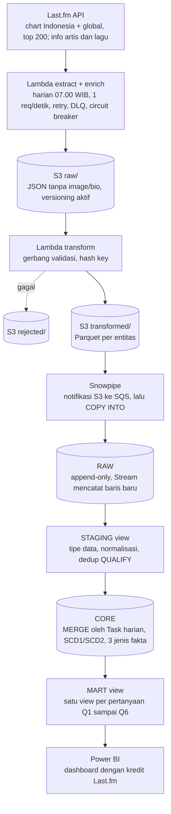

# Requirement Data — Music Chart Pipeline (Last.fm)

17 Oktober 2026 · Fahrul

## Keputusan sumber data

Sumber data project ini adalah **chart lagu Last.fm (Indonesia dan global)**, diambil harian.

Aturan pakai API Last.fm yang ikut jadi requirement ([API Terms of Service](https://www.last.fm/api/tos)):

| Aturan Last.fm                                                          | Dampak ke desain                                                                              |
| ----------------------------------------------------------------------- | --------------------------------------------------------------------------------------------- |
| Data hanya untuk tujuan non-komersial                                   | Project portofolio, aman. Tidak dijual atau dipakai di kantor                                 |
| Total data Last.fm yang disimpan dibatasi 100 MB (Reasonable Usage Cap) | Buang field yang tidak dipakai (gambar, bio/wiki) di tahap extract, dan pantau ukuran storage |
| Gambar, audio, dan artwork tidak termasuk izin pakai                    | Field `image` dibuang, tidak disimpan                                                         |
| Wajib mencantumkan kredit dan link ke Last.fm saat data ditampilkan     | Dashboard dan README menulis "Data: Last.fm" plus link ke halaman lagu/artis                  |
| Rate limit ditentukan Last.fm, angkanya tidak dipublikasikan            | Batas yang kita pasang sendiri: maksimal 1 request per detik                                  |

Sebelum mulai, satu hal masih harus dicek langsung: bikin API key, lalu tembak `geo.getTopTracks` dengan `country=Indonesia` sekali. Dokumentasinya aktif per Oktober 2026, tapi itu belum membuktikan endpoint-nya masih mengembalikan data.

## Pertanyaan bisnis

Dashboard menjawab satu pertanyaan besar: **lagu dan artis apa yang sedang naik di Indonesia, dan seberapa beda dengan selera global?** Pecahannya:

| #   | Pertanyaan                                                                                    | Tabel yang menjawab                         |
| --- | --------------------------------------------------------------------------------------------- | ------------------------------------------- |
| Q1  | Lagu apa yang paling lama bertahan di chart Indonesia, dan berapa hari?                       | `fact_chart_run`                            |
| Q2  | Lagu mana yang naik atau turun paling tajam dibanding kemarin dan minggu lalu?                | `fact_chart_daily` (window `LAG`)           |
| Q3  | Berapa lagu baru masuk dan keluar chart tiap minggu (churn)?                                  | `fact_chart_run`                            |
| Q4  | Berapa persen chart Indonesia yang juga ada di chart global hari ini?                         | `fact_chart_daily` (dua scope dibandingkan) |
| Q5  | Artis mana yang jumlah listener-nya tumbuh paling cepat?                                      | `fact_artist_stats_daily`                   |
| Q6  | Genre (tag) apa yang mendominasi chart Indonesia, dan bergeser bagaimana dari waktu ke waktu? | `fact_chart_daily` + `dim_artist` (SCD2)    |

Semua pertanyaan harus dijawab dari layer MART, dan setiap angkanya bisa ditelusuri balik ke file raw di S3.

## Peta materi ke project

Semua materi yang sudah dipelajari punya tempat yang jelas di project ini. Kalau ada materi yang tidak bisa ditunjuk bagiannya, berarti cuma ditempel, bukan dipakai.

| Materi                  | Dipakai di bagian   | Bentuk konkretnya                                                                                                                     |
| ----------------------- | ------------------- | ------------------------------------------------------------------------------------------------------------------------------------- |
| HTTP & API              | Extract             | `requests`, pagination `page`/`totalPages`, retry backoff + jitter, cek key `error` di body (bukan cuma `raise_for_status`)           |
| Error handling pipeline | Extract & enrich    | Klasifikasi error retry vs fatal, error budget, dead-letter queue, circuit breaker                                                    |
| Generator vs list       | Extract             | Generator yang `yield` per halaman chart, bukan menumpuk semua halaman di RAM                                                         |
| File I/O                | Extract & transform | Raw = JSON, transformed = Parquet, DLQ = JSONL                                                                                        |
| pandas                  | Transform           | Flatten JSON jadi tabel, normalisasi nama, hash key, dedup                                                                            |
| `dataclass`             | Transform           | Satu record tervalidasi per baris chart sebelum jadi DataFrame                                                                        |
| SQL lanjutan            | CORE & MART         | `LAG` untuk perubahan peringkat, gaps-and-islands untuk masa bertahan di chart, recursive CTE untuk `dim_date`, `QUALIFY` untuk dedup |
| Data modeling           | CORE                | Star schema, grain, conformed dimension, surrogate key, SCD1 vs SCD2, periodic vs accumulating snapshot, semi-additive measure        |
| Data warehousing        | Snowflake           | Layer RAW, STAGING, CORE, MART; ELT; `MERGE` idempotent; Streams + Tasks untuk proses incremental                                     |
| Snowflake               | Load & serving      | Storage integration, stage, file format, Snowpipe auto-ingest, warehouse XS + auto-suspend, Time Travel, zero-copy clone untuk dev    |
| AWS serverless          | Seluruh pipeline    | Lambda, S3 (partisi + lifecycle), EventBridge, SSM Parameter Store, SNS, CloudWatch, layer AWS SDK for pandas                         |
| Git                     | Seluruh project     | Satu kebiasaan baru per fase (lihat bagian terakhir)                                                                                  |
| Power BI                | Dashboard           | Q1 sampai Q6 dari layer MART                                                                                                          |

Sengaja tidak dipakai di sini: Airflow, dbt, Docker, Spark. Keempatnya masuk project berikutnya, dan `MERGE` manual di project ini nanti jadi pembanding ketika belajar dbt.

## Sumber data

Semua endpoint memakai base URL `https://ws.audioscrobbler.com/2.0/` dengan `api_key` dan `format=json`, tanpa OAuth. Ada dua jenis panggilan: **chart** (sedikit request, wajib berhasil) dan **enrich** (banyak request, satu per artis/lagu, boleh gagal sebagian).

| Endpoint             | Parameter                                    | Dipakai untuk                                      | Field yang diambil                                                                                       |
| -------------------- | -------------------------------------------- | -------------------------------------------------- | -------------------------------------------------------------------------------------------------------- |
| `geo.getTopTracks`   | `country=Indonesia`, `limit=50`, `page=1..4` | `fact_chart_daily` scope ID, top 200               | `@attr.rank`, `name`, `mbid`, `url`, `listeners`, `duration`, `artist.name`, `artist.mbid`, `artist.url` |
| `chart.getTopTracks` | `limit=50`, `page=1..4`                      | `fact_chart_daily` scope GLOBAL, top 200           | sama, plus `playcount`                                                                                   |
| `artist.getInfo`     | `artist=<nama>`, `autocorrect=1`             | `fact_artist_stats_daily`, `dim_artist`            | `stats.listeners`, `stats.playcount`, `tags.tag[].name`, `mbid`, `url`                                   |
| `track.getInfo`      | `artist`, `track`, `autocorrect=1`           | `dim_track` (hanya lagu yang belum ada di dimensi) | `album.title`, `duration`, `toptags.tag[].name`                                                          |

Hasil tes pertama `geo.getTopTracks` (17 Okt 2026) yang mengubah desain:

- **`@attr.rank` mulai dari 0**, bukan 1. Lagu teratas punya `rank: "0"`, jadi transform menyimpan `rank + 1`.
- **Semua angka dikirim sebagai string** (`"159"`, `"1207"`). Transform wajib cast ke integer dan menolak baris yang gagal di-cast.
- **Metriknya `listeners`, tanpa `playcount`** di chart Indonesia. `duration` dalam detik.
- `mbid` terisi di sampel, tapi tetap tidak dijadikan key karena belum tentu terisi untuk semua lagu.
- Chart Indonesia punya 10.000 baris (`total`), jadi top 200 selalu tersedia. Chart global juga mulai dari rank 0, dan mengirim `listeners` serta `playcount`; di chart Indonesia `playcount` selalu kosong (null).

Klasifikasi kode error Last.fm. Response error bisa datang dengan key `error` di body, jadi status HTTP saja tidak cukup:

| Kode                                    | Arti                                               | Perlakuan                                                                |
| --------------------------------------- | -------------------------------------------------- | ------------------------------------------------------------------------ |
| 8, 11, 16                               | Operation failed, service offline, error sementara | Retry dengan backoff + jitter                                            |
| 29                                      | Rate limit terlampaui                              | Retry dengan jeda lebih panjang; kalau berulang, circuit breaker terbuka |
| 6 di `artist.getInfo` / `track.getInfo` | Artis/lagu tidak ditemukan                         | Bukan error pipeline: catat ke dead-letter queue, lanjut item berikutnya |
| 6 di endpoint chart                     | Parameter salah                                    | Fatal, run gagal, alert                                                  |
| 4, 10, 26                               | Izin ditolak, API key salah, API key disuspend     | Fatal, tanpa retry, alert                                                |

Sumber: [geo.getTopTracks](https://www.last.fm/api/show/geo.getTopTracks)

## Model data (schema CORE)

Star schema dengan **tiga jenis fakta**: dua periodic snapshot (posisi harian) dan satu accumulating snapshot (perjalanan lagu di chart). Polanya sama dengan sistem custody: `fact_chart_daily` seperti posisi kepemilikan per rekening per tanggal, sedangkan `fact_chart_run` seperti satu baris per kontrak yang terus di-update sampai selesai.

| Tabel                     | Jenis                 | Grain (1 baris =)                                         | Key                                           | Kolom utama                                                                                                                                           |
| ------------------------- | --------------------- | --------------------------------------------------------- | --------------------------------------------- | ----------------------------------------------------------------------------------------------------------------------------------------------------- |
| `fact_chart_daily`        | Periodic snapshot     | 1 lagu di 1 chart pada 1 tanggal                          | (`snapshot_date`, `scope_key`, `track_key`)   | `rank`, `listeners`, `playcount`, `artist_key`, `load_ts`, `source_file`                                                                              |
| `fact_artist_stats_daily` | Periodic snapshot     | 1 artis pada 1 tanggal                                    | (`snapshot_date`, `artist_key`)               | `listeners`, `playcount` (kumulatif sepanjang masa)                                                                                                   |
| `fact_chart_run`          | Accumulating snapshot | 1 masa bertahan lagu di 1 chart, dari masuk sampai keluar | `run_id`                                      | `scope_key`, `track_key`, `entry_date`, `exit_date` (null kalau masih di chart), `entry_rank`, `peak_rank`, `peak_date`, `days_on_chart`, `is_active` |
| `dim_track`               | SCD1                  | 1 lagu                                                    | `track_key`                                   | `track_name`, `artist_key`, `mbid`, `album_name`, `duration_sec`, `url`                                                                               |
| `dim_artist`              | SCD2                  | 1 versi artis                                             | `artist_sk` (per versi); `artist_key` (tetap) | `artist_name`, `mbid`, `url`, `primary_tag`, `valid_from`, `valid_to`, `is_current`                                                                   |
| `dim_chart_scope`         | Statis                | 1 chart                                                   | `scope_key` (`ID`, `GLOBAL`)                  | `scope_name`                                                                                                                                          |
| `dim_date`                | Statis                | 1 hari kalender                                           | `date_key` (YYYYMMDD)                         | `date`, `day_of_week`, `is_weekend`, `iso_week`, `month`, `year`                                                                                      |
| `etl_run_log`             | Operasional           | 1 run per chart per tanggal                               | (`run_date`, `scope_key`)                     | `status`, `row_count`, `started_at`, `finished_at`                                                                                                    |

Aturan model:

- **Surrogate key wajib di sini.** Kebalikan dari Spotify: `mbid` di Last.fm sering kosong, jadi tidak bisa jadi key. `track_key` = hash dari `artist|track` yang sudah dinormalisasi (lowercase, trim, spasi ganda dirapikan); `artist_key` = hash dari nama artis yang dinormalisasi.
- **SCD2 di `dim_artist` untuk `primary_tag`.** Tag teratas artis bisa berubah. Tag Last.fm dibuat oleh user dan campur aduk antara genre dan non-genre (BTS punya "k-pop" dan "korean"), jadi `primary_tag` = tag pertama artis yang terdaftar di tabel referensi `ref_tag_genre` (tag → kelompok genre, diisi manual); kalau tidak ada yang cocok, nilainya `unknown`. Q6 butuh genre _pada saat itu_, jadi chart tanggal d di-join ke versi artis yang `valid_from <= d < valid_to` (point-in-time join). Perubahan `url` atau `mbid` cukup ditimpa (SCD1).
- **Measure semi-additive dan non-additive.** `listeners` dan `playcount` di `fact_artist_stats_daily` itu angka kumulatif, sama seperti saldo rekening: tidak boleh dijumlah antar hari. Pertumbuhan harian dihitung pakai `LAG`. `rank` sama sekali tidak bisa dijumlah; yang masuk akal cuma `MIN`, `AVG`, atau perubahannya.
- **`fact_chart_run` dibangun ulang dengan gaps-and-islands.** "Berturut-turut" dihitung dari tanggal yang run-nya sukses di `etl_run_log`, bukan dari kalender. Tanpa aturan ini, satu hari pipeline gagal akan memotong semua run jadi dua dan Q1 jadi salah.
- **`dim_date` dibuat dengan recursive CTE**, rentang 2026-01-01 sampai 2027-12-31.
- **Keterbatasan yang diterima:** lagu kolaborasi tercatat dengan satu string artis (misalnya "A feat. B"), jadi tidak ada bridge track-artist.

## Layer warehouse

Raw di S3 adalah sumber kebenaran. Kalau ada bug di transform atau `MERGE`, semua layer sesudahnya bisa dibangun ulang dari raw, dan Time Travel Snowflake jadi jaring pengaman untuk salah `MERGE` di CORE. STAGING dan MART cukup berupa view, karena datanya kecil dan logikanya lebih penting daripada performanya.

- **S3:** `raw/chart/scope=<ID|GLOBAL>/dt=YYYY-MM-DD/page=N.json`, `raw/enrich/dt=YYYY-MM-DD/`, `transformed/<entitas>/dt=YYYY-MM-DD/*.parquet`, `rejected/`, `dlq/`
- **Snowflake:** database `MUSIC_CHART`, schema `RAW`, `STAGING`, `CORE`, `MART`; database clone `MUSIC_CHART_DEV` (zero-copy) untuk eksperimen tanpa merusak data asli

## Requirement non-fungsional

Fakta paling menentukan di bagian ini: **chart Last.fm tidak bisa diambil mundur.** Tidak ada parameter tanggal di `geo.getTopTracks`, jadi hari yang terlewat hilang selamanya. Itu sebabnya monitoring dan alert lebih penting daripada kecepatan.

| Area                     | Requirement                                                                                                                                                                    |
| ------------------------ | ------------------------------------------------------------------------------------------------------------------------------------------------------------------------------ |
| Jadwal                   | EventBridge harian jam 07.00 WIB (00.00 UTC) memicu Lambda `extract_charts`                                                                                                    |
| Urutan                   | `extract_charts` menulis raw; file itu memicu Lambda `enrich` (artis dan lagu); file enrich memicu Lambda `transform`                                                          |
| `snapshot_date`          | Tanggal WIB saat run, bukan tanggal UTC                                                                                                                                        |
| Pagination               | Generator yang `yield` per halaman, berhenti di `totalPages` atau halaman 4, mana yang lebih dulu                                                                              |
| Throttle                 | Maksimal 1 request per detik ke Last.fm (batas yang kita pasang sendiri)                                                                                                       |
| Retry                    | Maksimal 3 percobaan, exponential backoff mulai 2 detik + jitter, hanya untuk HTTP 5xx dan kode Last.fm 8, 11, 16, 29                                                          |
| Circuit breaker          | 5 error 29/11 berturut-turut: berhenti memanggil API di run itu, sisa item masuk DLQ                                                                                           |
| Dead-letter queue        | Item enrich yang gagal ditulis ke `dlq/dt=YYYY-MM-DD/enrich.jsonl`. Run berikutnya mencoba DLQ lebih dulu. Setelah 3 hari gagal, item dilaporkan dan dibuang                   |
| Error budget             | Chart: 0% gagal (fatal). Enrich: kalau lebih dari 10% item gagal, run ditandai FAILED di `etl_run_log` dan alert, tapi data yang berhasil tetap di-load                        |
| Idempotensi              | Path raw deterministik per tanggal dan halaman, S3 versioning aktif, jadi run ulang tidak menghapus apa-apa. Snowflake pakai `MERGE` di primary key, bukan `INSERT`            |
| Batas simpan 100 MB      | Field `image`, `bio`, dan `wiki` dibuang sebelum ditulis ke raw. Ukuran bucket dan tabel Snowflake dicek harian; alert kalau total melewati 70 MB                              |
| Chart yang tidak berubah | Snapshot tetap disimpan setiap hari. Kalau isi chart identik dengan kemarin, tulis log INFO. Dari log itu nanti terlihat seberapa sering Last.fm benar-benar memperbarui chart |
| Secret                   | `api_key` di SSM Parameter Store (SecureString); `.env` lokal masuk `.gitignore`                                                                                               |
| Alert                    | Run gagal, error budget terlampaui, atau Snowpipe gagal load: email lewat SNS                                                                                                  |
| Biaya                    | Warehouse Snowflake XS, auto-suspend 60 detik; Task jalan sekali sehari                                                                                                        |
| Region                   | Semua resource AWS di satu region; cek ketersediaan Snowflake di region bucket sebelum bikin akun trial                                                                        |

## Aturan kualitas data

Setiap aturan punya tempat cek dan aksi yang jelas kalau gagal. Gerbang transform menolak data sebelum masuk; cek CORE jalan setelah `MERGE`.

| Aturan                                                                                                                                 | Di mana             | Kalau gagal                                            |
| -------------------------------------------------------------------------------------------------------------------------------------- | ------------------- | ------------------------------------------------------ |
| Response chart punya `tracks.track` dan `@attr.totalPages`, tanpa key `error`                                                          | Transform (gerbang) | Run gagal, alert                                       |
| Tiap baris chart punya `rank`, `name`, `artist.name` yang tidak kosong                                                                 | Transform (gerbang) | Baris ke `rejected/`                                   |
| `rank` dari API mulai 0; setelah disimpan sebagai rank + 1, harus unik dan berurutan 1..N per scope per tanggal                        | Transform           | Run gagal, alert (tanda pagination salah)              |
| Satu chart per hari minimal 50 baris                                                                                                   | Transform           | Alert                                                  |
| Primary key unik di setiap fakta                                                                                                       | CORE                | Alert (tanda `MERGE` salah)                            |
| Setiap `track_key` dan `artist_key` di fakta ada di dimensinya                                                                         | CORE                | Alert, laporkan key yang yatim                         |
| Tiap `artist_key` di `dim_artist` punya tepat satu baris `is_current = true`, dan rentang `valid_from`/`valid_to` tidak tumpang tindih | CORE                | Alert (tanda SCD2 rusak)                               |
| `listeners` artis tidak turun lebih dari 20% dari kemarin                                                                              | CORE                | Peringatan, bukan gagal: bisa artefak autocorrect nama |
| Setiap tanggal sejak pipeline mulai punya run SUCCESS di `etl_run_log` untuk kedua scope                                               | Monitoring          | Alert, karena tanggal itu tidak bisa diambil ulang     |

## Di luar scope & prasyarat

Di luar scope:

- Data historis sebelum pipeline jalan (API tidak menyediakan)
- Chart per kota (`location`) dan chart per tag; bisa ditambah setelah inti stabil
- Gambar, cover album, bio artis (dilarang disimpan atau tidak dipakai)
- Pemakaian komersial atau di lingkungan kantor
- Airflow, dbt, Docker, Spark (project berikutnya)

Prasyarat sebelum mulai:

- [ ] Akun Last.fm + API key, sudah dites `geo.getTopTracks` dengan `country=Indonesia`
- [ ] Akun AWS dengan billing alert
- [ ] Akun Snowflake trial di region yang cocok dengan bucket
- [ ] Power BI Desktop (hanya jalan di Windows)
- [ ] Akun GitHub + Git terpasang di laptop

## Fase pengerjaan + latihan Git

Tiap fase selesai = ada yang bisa didemokan, plus satu kebiasaan Git baru. Fase 3 sengaja didahulukan dari Snowflake supaya data mulai terkumpul secepat mungkin, karena hari yang lewat tidak bisa diambil ulang.

1. **Repo.** `git init`, `.gitignore` (`.env`, `__pycache__/`, `*.zip`), README, dokumen ini sebagai `docs/requirements.md`, push ke GitHub.
   - Git: `init`, `add`, `commit`, `remote`, `push`
2. **Extract lokal.** Script Python: pagination dengan generator, throttle, retry, klasifikasi error, simpan JSON ke folder lokal.
   - Git: commit kecil per fungsi, pesan commit yang jelas
3. **Extract + enrich di AWS.** Lambda `extract_charts` + EventBridge harian, Lambda `enrich` dengan DLQ, error budget, dan circuit breaker. Mulai kumpulkan raw ke S3 setiap hari.
   - Git: kerja di branch `feat/extract`, merge ke `main`
4. **Transform.** Lambda dengan layer AWS SDK for pandas: gerbang validasi, flatten, hash key, tulis Parquet ke `transformed/` dan baris gagal ke `rejected/`.
   - Git: pull request ke repo sendiri, tag `v0.1`
5. **Snowflake RAW.** Storage integration, stage, file format, tabel RAW, Snowpipe auto-ingest. Backfill semua file yang sudah terkumpul sejak fase 3.
   - Git: semua DDL sebagai file `.sql` di folder `snowflake/`, bukan cuma diketik di worksheet
6. **STAGING + CORE.** View STAGING, `MERGE` ke dimensi (SCD1 dan SCD2) dan fakta, Streams + Tasks harian, `fact_chart_run` dengan gaps-and-islands, cek kualitas data.
   - Git: satu branch per tabel inti, `git diff` sebelum setiap commit
7. **MART + Power BI.** View MART untuk Q1 sampai Q6, dashboard dengan kredit Last.fm.
   - Git: README final dengan diagram arsitektur dan screenshot dashboard, siap dipajang di CV
